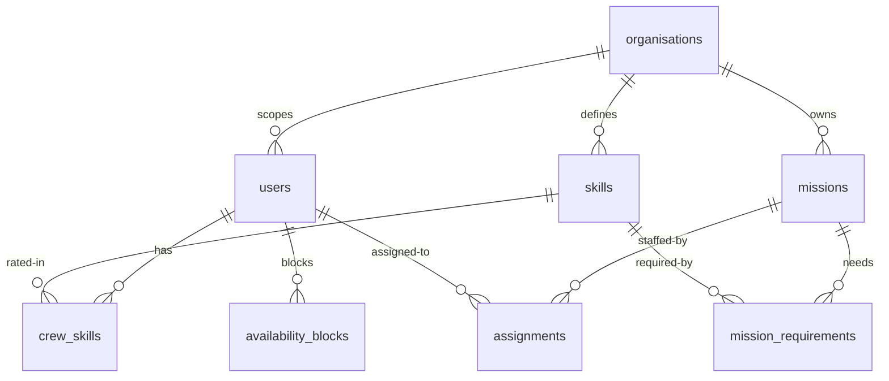
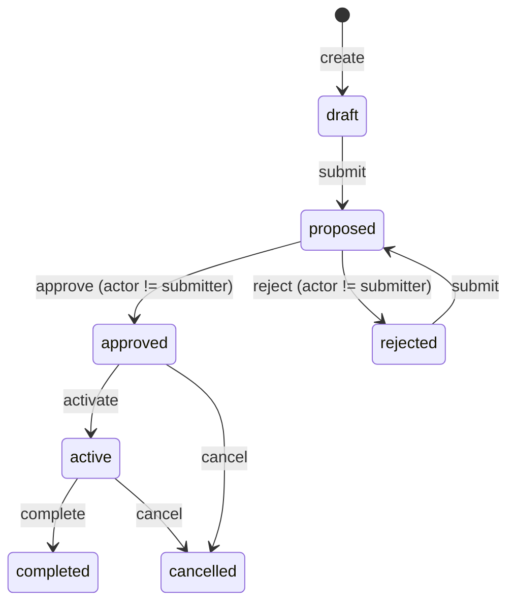

# Mission Control — Design Document (v1)

## 1. Goal
Multi-tenant B2B platform for space orgs to plan missions and assign crew by skills, availability, workload. Working vertical slice: API + CLI. No web UI.

Timebox: 3–5h. Prefer working slice + verification over breadth.

## 2. Stack
- TypeScript + Node 22, Fastify (routing, validation, plugins), zod (shared schemas), commander (CLI), better-sqlite3 (single file, no Docker), vitest (tests).
- One repo, two processes: `npm run api` (Fastify), `npm run cli -- <cmd>` (HTTP client). Shared `src/schemas`.
- SQLite files: `schema.sql` (migrations), `seed.ts` (reset + representative data).

Why: aligns with evaluator stack, minimal infra, real network boundary for tenancy tests.

## 3. Key assumptions (explicit)
1. Single org per user: `users.org_id` FK. Multi-org membership is non-goal.
2. Demo auth: `x-user-id` header IS the bearer token (seeded IDs, `cli --as <id>`). No login/logout/token table. Server derives `org/role` from user row. Production swaps `auth()` for JWT verify; scoping logic unchanged.
3. Never trust client org: all queries filter `org_id = actor.org_id`.
4. Skill catalog per org; proficiency 1–5.
5. Availability = explicit `availability_blocks` + derived busy from overlapping accepted assignments. Both are hard filters.
6. Peer approval allowed (see Section 5).

## 4. Data model

- `organisations(id TEXT PK, name TEXT)`
- `users(id TEXT PK, org_id FK, role TEXT director|lead|crew, name TEXT)`
- `skills(id TEXT PK, org_id FK, name TEXT UNIQUE per org)`
- `crew_skills(user_id FK, skill_id FK, level INT 1-5, PK(user_id,skill_id))`
- `missions(id TEXT PK, org_id FK, title TEXT, status TEXT, start_date ISO, end_date ISO, created_by FK, submitted_by FK NULL, approved_by FK NULL)`
- `mission_requirements(mission_id FK, skill_id FK, min_level INT, min_count INT, PK(mission_id,skill_id))`
  - Semantics: need `min_count` distinct crew with `level >= min_level` for that skill.
- `assignments(id TEXT PK, mission_id FK, user_id FK, status TEXT proposed|accepted|declined, score REAL NULL, reasons JSON NULL)`
- `availability_blocks(id TEXT PK, user_id FK, start_date ISO, end_date ISO, reason TEXT NULL)`

Indexes: `users(org_id)`, `missions(org_id,status)`, `assignments(mission_id,user_id)`.

## 5. Roles (hierarchical, cumulative)
- Crew: own profile/skills, own blocks (`POST/GET/DELETE /availability`), view own assignments, `respond accept/decline`.
- Lead: crew-self powers + `missions create/edit/requirements/match/propose/submit/activate/complete/cancel`, `approve/reject` others' missions.
- Director: lead powers + skill catalog CRUD + full org visibility + settings.
- Rule: roles only gain going up. Only restriction carried up is SoD (see below).

### 5.1 Separation of Duties (SoD)
SoD = no one may approve or reject a mission they submitted themselves.
- Applies to all approver roles (lead and director). E.g. lead-1 submits M1 → lead-1 `approve` fails, lead-2 or director may approve. Same if director submits.
- Enforced server-side in `approve`/`reject` handlers: if `mission.submitted_by == actor.id` → `403 {code: SELF_APPROVAL}`.
- Audited via `missions.submitted_by` / `missions.approved_by` columns.
- Tested: submit-as-A + approve-as-A fails; approve-as-B succeeds.

## 6. Mission lifecycle (explicit state machine)

States: `draft → proposed → approved → active → completed`, plus `proposed → rejected → draft`, `approved/active → cancelled`.

Transitions (actor):
- `create → draft`: lead, director
- `submit: draft|rejected → proposed`: lead, director (sets `submitted_by = actor`)
- `approve: proposed → approved`: lead, director if `actor != submitted_by` (sets `approved_by`)
- `reject: proposed → rejected`: lead, director if `actor != submitted_by`
- `activate: approved → active`: lead, director (manual endpoint, no cron)
- `complete: active → completed`: lead, director
- `cancel: approved|active → cancelled`: lead, director

Rules:
- Invalid transitions → 409. Single `transition()` function owns table; handlers call it.
- Matcher + `POST /assignments` only when mission in `draft|proposed`. Locked after `approved`.
- Crew `respond` allowed in `proposed|approved|active`.

## 7. Matching engine (two-stage, explainable)
`GET /missions/:id/matches → [{user_id, name, score, breakdown{skill,workload}, gaps[]}]` sorted desc.

Hard filters (exclude):
- `user.org_id != mission.org_id`
- date overlap with `availability_blocks` OR `assignments(status=accepted)` — `proposed` does not block, to avoid tentative holds.
  - Overlap test: `NOT (mission.end < busy.start OR mission.start > busy.end)`
- zero overlapping required skills.

Score 0–1:
- `skill (0.75)`: per requirement `min(crew_level/min_level,1.2)/1.2` averaged, 0 if missing. Weighted by `min_count` implicitly via coverage reporting.
- `workload (0.25)`: `1/(1+active_assignments)` where active = `accepted` on `approved|active` missions.
- `gaps[]`: e.g. `piloting: need L3 x2, have L2 (1/2 covered)`.

No slack term (cut). Deterministic, no ML. Tune weights after seed demo.

## 8. API (REST, `x-user-id` auth)
Middleware: `auth()` loads user → `{user,org,role}`; `requireRole(min)`; tenant check `resource.org_id == actor.org_id`.

- `GET /users` (scoped list for `--as` discovery)
- `POST /missions, GET /missions, GET /missions/:id`
- `POST /missions/:id/requirements`
- `GET /missions/:id/matches`
- `POST /assignments {mission_id,user_id}` (creates `proposed` + stores score/reasons)
- `POST /assignments/:id/respond {accept:bool}` (crew own, or director)
- `POST /missions/:id/submit|approve|reject|activate|complete|cancel`
- `GET /crew, PATCH /users/:id/skills {skills:[{skill_id,level}]}` (own or director)
- `POST /skills, GET /skills` (director)
- `POST /availability, GET /availability, DELETE /availability/:id`

Errors: `{error:{code,message,details}}`. 401 anon, 403 role/tenant, 404 scoped to org (no leak), 409 bad transition.

## 9. CLI (commander, thin client)
Global: `--as <user-id> --json --api <url>`.
- `missions list|create --title --start --end|show <id>|submit|approve|reject|activate|complete|cancel <id>`
- `requirements add <mission-id> --skill <name> --min-level --count`
- `match <mission-id>` (pretty table + reasons, `--json` for script)
- `assignments propose <mission-id> <user-id>|respond <assignment-id> --accept|--decline`
- `crew list|profile|skills set --skill --level`
- `availability add --start --end [--reason]|list|remove <id>`
- `skills list|add <name>` / `users list`

UX: human tables by default, `--json` for piping, clear 403/409 messages, `users list` to discover `--as` IDs.

## 10. Seed (proves the story)
- 2 orgs (OrgA, OrgB) to test isolation.
- Per org: 1 director, 2 leads, 5 crew with varied levels; skill catalog `piloting,eva,medical,engineering`.
- Missions: M1 needs `piloting L3 x2` (only 1 qualified → gap demo); M2 overlaps M1 dates (double-book filter demo); M3 fully coverable.
- Blocks: 1 crew on leave overlapping M1. Assignments: 1 accepted overlapping M2.
- `npm run seed` resets DB.

## 11. Project layout
`src/{server.ts,routes/*.ts,services/{matcher.ts,lifecycle.ts,auth.ts},db/{schema.sql,client.ts,seed.ts},schemas.ts} cli/{index.ts,commands/*.ts} tests/{tenancy.test.ts,sod.test.ts,lifecycle.test.ts,matcher.test.ts}`

## 12. Non-goals / extension points
- Non-goals: real auth, multi-org users, per-org configurable approval workflows (v1 uses single workflow for all orgs despite brief noting orgs differ — configurability is the live extension), recurring availability, hours-based workload, notifications, resources/equipment, UI, cron auto-activate.
- Extensions: `is_available()` gains new table easily; matcher adds term (e.g. `resource 0.2`, renormalize); `transition()` table gains `peer_review` state or per-org workflow config; `requireRole` → per-permission map; `auth()` → JWT.

## 13. Verify
- `npm run api` + `npm run cli -- users list`
- Manual: create → requirements → match → propose → submit (lead-1) → approve as lead-1 fails (SoD) → approve as lead-2/director succeeds.
- `npm test`: tenant leak test (OrgA cannot fetch OrgB mission → 404), SoD test, illegal `draft→approved` → 409, matcher ranking + gap test.

## 14. Agent build order + guardrails
Build in order: `1 schema+seed → 2 auth/tenancy middleware → 3 lifecycle transition() → 4 matcher → 5 assignments → 6 CLI`.
Constraints: no ORM, no auth lib, no new mission states without updating Section 6 diagram, no client-supplied `org_id`, all new routes need tenant + role test.

## 15. Submission artifacts
- This file (`DESIGN.md`) is the pre-implementation design doc.
- `README.md` (to write at build time): setup, `npm install/run/seed`, CLI examples.
- Full unedited AI transcripts including this thread.
